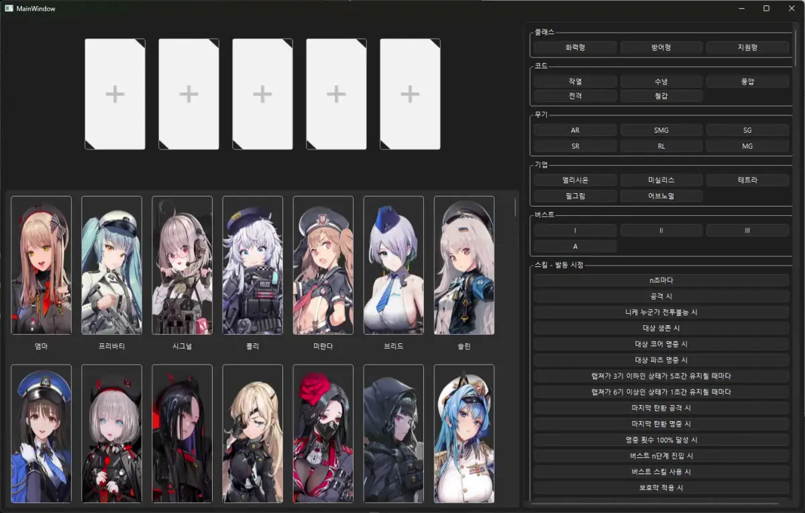

# 승리의 여신 : 니케 덱 빌더

니케 캐릭터 정보를 DB로 관리하고, 스킬 키워드 기반으로 필터링할 수 있는 데스크탑 애플리케이션입니다.

# Download
- [portable-window](https://github.com/J-seunghwan/deck_builder/releases)

# 사용 방법
1. 위 링크에서 최신 릴리스를 다운로드합니다.
2. 압축 해제 후 `Deck_Builder.exe`을 실행합니다.

# 주요 기능
- 캐릭터 정보 관리 : 크롤링을 통한 니케 캐릭터 정보 DB화
    * 파이썬 코드 한정
- 스킬 키워드 필터링 : 원하는 스킬 조건으로 캐릭터 검색
- 자동 업데이트 : `GitHub Release`와 연동된 자동 업데이트
    * 프로그램 실행 시 최신 업데이트가 있다면 업데이트를 진행합니다.

# 개발 환경
- Windows 11
- Qt6 C++
- Python 3.14.3
    - selenium 4.41.0
    - requests 2.32.5
- SQLite
- AI Assistant : Gemini -> Claude

# 개발 비화
- **만든 이유**
    - 니케 게임에서 스킬 키워드 필터링이 불친절하고, 이런 프로그램을 만들어 보고 싶었음.
- **크롤링을 사용하는 이유**
    - 니케가 공식 API를 제공하지 않으며, 게임 내 스킬 필터링 기능이 많이 제한됨
    - 정확한 정보와 이미지를 가져오기 위해 블라블라링크를 크롤링
- **AI를 활용하는 이유**
    - 서브컬쳐 게임의 스킬 설명이 복잡하고 캐릭터 수가 많아 텍스트 패턴 분석에 AI가 필요. 비문학 텍스트를 정제하기가 까다로움
    - Claude를 통해 스킬 키워드 추출 작업을 수행
        * DB_manager_nikke.py로 xlsx 파일 생성 및 해당 결과 반영
- **SQLite를 사용하는 이유**
    - 처음 DB를 다뤄보는 프로젝트로, 사용성과 접근성이 가장 좋다고 판단

# Todo
### 기능 고도화
- [ ] 애장품 적용 니케 추가
- [ ] 니케 정보 자세히 보기
- [ ] 파티 구성 저장 기능 추가
- [ ] 앱 내 업데이트 내역 표시
- [ ] 버스트 단계가 여러 개인 니케 필터링 개선
- [X] 스킬 키워드 목록 생성 및 필터링 개선
### UI/UX 개선
- [ ] 휠 조작 시 스크롤 이동값 개선
- [ ] 색상 변경 기능 추가
- [ ] 니케 목록 로딩 시 애니메이션 효과 추가

# 주의
- 본 프로그램은 개인적인 학습 및 편의를 위해 제작되었으며, 영리 목적으로 제작되지 않았습니다.
- '승리의 여신 : 니케 (GODDESS OF VICTORY: NIKKE)'의 저작권은 SHIFT UP 및 Level Infinite에 있습니다.
- [시프트업 2차 창작활동 가이드라인](https://policy.shiftup.co.kr/ip/kr/index.html)